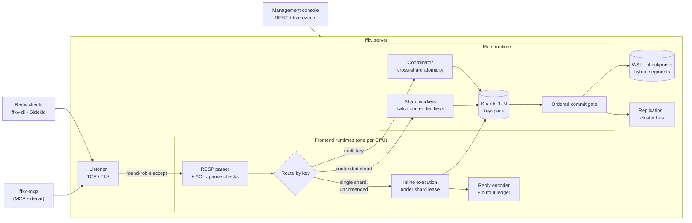

<p align="center">
  
</p>

<p align="center">
  <b>freaking fast KV</b>: a Redis-compatible datastore in Rust, built for queues and background jobs.<br>
  <a href="https://ffkv.pages.dev/">Handbook</a> ·
  <a href="https://ffkv.pages.dev/getting-started/quickstart/">Quickstart</a> ·
  <a href="https://ffkv.pages.dev/reference/commands/">Command reference</a> ·
  <a href="#performance">Benchmarks</a>
</p>

---

ffkv speaks RESP2/RESP3, so existing Redis clients, `redis-cli` and Sidekiq work
unchanged. It adds the parts a background-job backend usually bolts on: durable
logs, a RAM/SSD hybrid mode, native leased jobs and a management console.

- **Redis 8.10 command surface.** All 486 catalog entries and 19 datatype families, from strings, lists and streams to JSON, vector sets, time series and probabilistic sketches.
- **Fast on multi-core.** Faster than Dragonfly in all 27 matched benchmark cases. See [Performance](#performance).
- **Durable when you want it.** A checksummed WAL with `strict` (fsync per write) or `everysec`, plus checkpoints, online backups and offline restore.
- **Built for jobs.** Blocking list queues, native leased jobs with acknowledgements, and Lua, transactions and Pub/Sub. The pinned Sidekiq integration is tested.
- **Operable.** TLS, ACLs, Prometheus metrics, an authenticated React console, native replication, cluster mode and an MCP sidecar for AI tools.

> **Status: alpha.** ffkv is extensively tested (Rust tests plus a BDD suite that
> covers every catalog entry), but it is not production-certified or fully
> Redis-binary-compatible. Read [compatibility](https://ffkv.pages.dev/concepts/compatibility/)
> before relying on it.

## Quickstart

### Docker

```sh
docker run -d --name ffkv -p 6379:6379 -v ffkv-data:/var/lib/ffkv ghcr.io/akhil-gautam/ffkv
docker exec ffkv ffkv-cli PING                        # PONG
docker exec ffkv ffkv-cli SET greeting 'hello ffkv'   # OK
```

The image runs on amd64 and arm64, uses durable `strict` mode, and generates TLS
and an `admin` password on first start, stored in the volume. To connect from your machine:

```sh
docker cp ffkv:/var/lib/ffkv/docker/ca.crt ./ffkv-ca.crt
REDISCLI_AUTH="$(docker exec ffkv cat /var/lib/ffkv/docker/admin-password)" \
  redis-cli --tls --cacert ./ffkv-ca.crt --user admin PING
```

Settings such as your own password, extra certificate names and Compose with
the web console are covered in the [Docker guide](https://ffkv.pages.dev/deployment/docker/).

### From source

You need Rust 1.99 or newer and a C toolchain. No Redis installation is required.

```sh
cargo build --release --bins
target/release/ffkv --bind 127.0.0.1:6380            # memory-only; data is gone on exit
```

In another terminal:

```sh
target/release/ffkv-cli PING                          # PONG
target/release/ffkv-cli SET greeting 'hello ffkv'     # OK
target/release/ffkv-cli INCR visits                   # 1
target/release/ffkv-cli LPUSH jobs '{"id":1}'         # 1
target/release/ffkv-cli BRPOP jobs 0                  # jobs, {"id":1}
```

`ffkv-cli` defaults to `127.0.0.1:6380`. Any Redis client works too, for example
`redis-cli -p 6380`.

**Keep your data.** Add a data directory and choose a durability policy:

```sh
target/release/ffkv --bind 127.0.0.1:6380 --data-dir ./ffkv-data --durability strict
```

| Goal | Flags | Guide |
| --- | --- | --- |
| Fsync before every reply | `--data-dir DIR --durability strict` | [Persistence](https://ffkv.pages.dev/operations/persistence/) |
| Fsync about once a second | `--data-dir DIR --durability everysec` | [Persistence](https://ffkv.pages.dev/operations/persistence/) |
| Spill large list items and job bodies to SSD | `--storage hybrid --data-dir DIR` | [Hybrid storage](https://ffkv.pages.dev/operations/hybrid-storage/) |
| TLS and named users | `--tls-cert`, `--tls-key`, `--acl-file` | [Security](https://ffkv.pages.dev/operations/security/) |
| Web console and management API | `--management-bind`, `--management-token-file` | [Console](https://ffkv.pages.dev/getting-started/console/) |
| Docker Compose / Kubernetes | `deploy/` | [Docker](https://ffkv.pages.dev/deployment/docker/), [Kubernetes](https://ffkv.pages.dev/deployment/kubernetes/) |

Every flag is listed in the [configuration reference](https://ffkv.pages.dev/reference/configuration/).

## Performance

These are commands per second for 32 clients at pipeline depth 16. Each figure is
the median of two runs, memory-only. Each engine was a fresh server on four
pinned CPUs.

| Workload | ffkv | Dragonfly 2.0.2 | Redis 8.2.1 | vs Dragonfly | vs Redis |
| --- | ---: | ---: | ---: | ---: | ---: |
| GET 256 B | 2,941,042 | 2,603,375 | 2,082,643 | **1.13×** | 1.41× |
| SET 256 B | 2,634,198 | 2,427,828 | 1,736,991 | **1.09×** | 1.52× |
| GET 4 KiB | 1,840,583 | 1,155,995 | 795,787 | **1.59×** | 2.31× |
| SET 4 KiB | 1,641,558 | 1,097,966 | 494,416 | **1.50×** | 3.32× |
| INCR | 3,076,196 | 2,971,252 | 2,079,936 | **1.04×** | 1.48× |
| HGET | 2,826,854 | 2,599,985 | 1,689,266 | **1.09×** | 1.67× |
| HSET | 2,628,055 | 2,447,099 | 1,514,368 | **1.07×** | 1.74× |
| ZADD | 2,398,487 | 1,835,926 | 548,041 | **1.31×** | 4.38× |
| ZRANGE (10 members) | 1,786,067 | 1,485,170 | 1,094,335 | **1.20×** | 1.63× |

Across all 27 cases (nine workloads × three client profiles), ffkv beat Dragonfly
in **27/27** and Redis in **18/27**. With 32 clients and no pipelining it was
1.35–1.81× Dragonfly. With a single client it was 1.61–1.67× Dragonfly. In that
single-client case, single-threaded Redis stays 0.5–4% ahead.

All engines used one ARM64 Linux VM on an Apple M4, with `redis-benchmark` 8.2.1
on separate CPUs. The results are memory-only with two runs per case, so they
show no statistical significance. The
[benchmark guide](https://ffkv.pages.dev/contributing/benchmarks/) has every
table, the cross-check with other load generators, the method and the
reproduction commands. Raw data is in
[`benchmarks/results/`](benchmarks/results/dragonfly-vs-ffkv-2026-11-03/wave7b-analysis.json).

## Architecture



- **Connections:** each connection is pinned to one frontend runtime. It parses and runs most commands inline under an exclusive shard lease, with no extra hop.
- **Contended keys:** when several frontends compete for one shard, its worker runs the queued commands in batches. A hot key therefore doesn't bounce between CPUs.
- **Cross-shard commands:** commands such as `MSET`, `RENAME` and set stores go through the coordinator, which keeps them atomic.
- **Durability:** a write is committed through one ordered gate to the WAL before any reader sees it. Replication streams the same resolved effects.

More detail: [architecture](https://ffkv.pages.dev/concepts/architecture/).

## Documentation

| I want to… | Read |
| --- | --- |
| Install and try it | [Installation](https://ffkv.pages.dev/getting-started/installation/), [Quickstart](https://ffkv.pages.dev/getting-started/quickstart/), [CLI](https://ffkv.pages.dev/getting-started/cli/) |
| Use a datatype | [Datatypes](https://ffkv.pages.dev/data-types/), [Command reference](https://ffkv.pages.dev/reference/commands/) |
| Run jobs | [List queues](https://ffkv.pages.dev/guides/list-queues/), [Native jobs](https://ffkv.pages.dev/guides/native-jobs/), [Sidekiq](https://ffkv.pages.dev/guides/sidekiq/) |
| Operate it | [Backup & restore](https://ffkv.pages.dev/operations/backup-restore/), [Replication](https://ffkv.pages.dev/operations/replication/), [Clustering](https://ffkv.pages.dev/operations/clustering/), [Observability](https://ffkv.pages.dev/operations/observability/) |
| Connect AI tools | [MCP sidecar](https://ffkv.pages.dev/guides/mcp/) |
| Know the limits | [Compatibility](https://ffkv.pages.dev/concepts/compatibility/), [Limits](https://ffkv.pages.dev/reference/limits/) |

## Contributing

```sh
cargo test --locked --all-targets
cargo clippy --locked --all-targets -- -D warnings
npm --prefix apps/docs ci && npm --prefix apps/docs run dev   # handbook at localhost:4321
```

See [development](https://ffkv.pages.dev/contributing/development/),
[testing](https://ffkv.pages.dev/contributing/testing/) (including the BDD
suite) and [benchmarks](https://ffkv.pages.dev/contributing/benchmarks/). The
handbook source is in [`apps/docs`](apps/docs).

ffkv uses [Semantic Versioning](https://semver.org/). Changes are listed in
[CHANGELOG.md](CHANGELOG.md), and the release steps are in the
[development guide](https://ffkv.pages.dev/contributing/development/#versions-and-releases).
